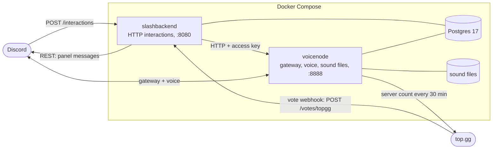

  <picture>
    <source media="(prefers-color-scheme: dark)" srcset="assets/branding/wordmark-dark-bg.svg">
    <source media="(prefers-color-scheme: light)" srcset="assets/branding/wordmark-light-bg.svg">
    
  </picture>

  A Discord soundboard bot: upload your own sounds, play them in voice, and discover what others uploaded.

  <a href="https://discord.com/oauth2/authorize?client_id=503996428042108928&permissions=8797169912832&scope=bot+applications.commands">Add to server</a>
  ·
  <a href="https://top.gg/bot/503996428042108928">top.gg</a>
  ·
  <a href="https://discord.gg/5bfhkJ3">Support server</a>

  
  

The invite asks for View Channels, Send Messages, Connect, Speak, Create Expressions and Manage Expressions, with the
`bot` and `applications.commands` scopes (the same link `/invite` posts).

## About this version

I wrote Better Airhorn by hand years ago, as a side project. I no longer have the time to keep it up that way, so v5
was rebuilt and updated with the help of AI (Claude): the move to current libraries, the rewrite of both services, the
new features and these docs. If AI-written code is a problem for you, please don't use or host this version. The
hand-written code is still on the [`v4`](https://github.com/better-airhorn/better-airhorn/tree/v4) branch.

## Compared to Discord's built-in soundboard

Discord's own soundboard keeps a few short clips per server (5.2 s and 512 KB each). Better Airhorn adds:

- Longer sounds, and more of them: only your [storage](#limits-and-votes) limits them, not slots or seconds.
- Sounds on every server. Each sound is visible to Everyone, This server (the one it was uploaded on) or Only me, so a
  public sound plays on every server the bot is on.
- Search as you type (typos included), recommendations based on likes, `/list` and `/random`.
- Uploads in any common audio format or from an existing voice message. You trim them in the upload form, and every
  sound is loudness-normalised so they all play at a similar volume.
- Panels, entrance sounds, likes, sharing as a file, and `/export` to copy a clip into the built-in soundboard.

The trade-off: the built-in soundboard plays instantly, while Better Airhorn joins your voice channel and plays
through a per-server queue.

## Commands

| Command                                     | What it does                                                                                                  | Who                                                 | Where                   |
| ------------------------------------------- | ------------------------------------------------------------------------------------------------------------- | --------------------------------------------------- | ----------------------- |
| `/play sound`                               | Plays a sound in your voice channel. Autocomplete searches as you type; an empty query shows recommendations. | everyone                                            | server                  |
| `/random`                                   | Plays a random sound you can use here.                                                                        | everyone                                            | server                  |
| `/upload`                                   | Opens a form: audio file, name, who can play it, optional start and end in seconds.                           | everyone                                            | server                  |
| **Save as sound** (message menu → Apps)     | Imports an audio attachment or voice message from that message through the same form.                         | everyone                                            | server                  |
| `/list all` · `/list server` · `/list mine` | Browses sounds by likes and plays, 10 per page, with a picker to play one. `mine` also shows your storage.    | everyone                                            | server, DM with the bot |
| `/info sound`                               | Length, size, uploader, visibility, plays, likes and dislikes.                                                | everyone                                            | server, DM with the bot |
| `/delete sound`                             | Deletes the sound and its file.                                                                               | the uploader, bot admins                            | server, DM with the bot |
| `/share sound`                              | Posts the sound as an `.ogg` file.                                                                            | everyone                                            | server, DMs, group DMs¹ |
| `/skip`                                     | Skips the sound that is playing.                                                                              | members in the bot's channel, or with Manage Server | server                  |
| `/clear`                                    | Stops playback and empties the queue.                                                                         | members in the bot's channel, or with Manage Server | server                  |
| `/leave`                                    | Disconnects the bot.                                                                                          | members in the bot's channel, or with Manage Server | server                  |
| `/entrance set sound`                       | Sets your sound that plays when you join a voice channel on this server (at most 10 s).                       | everyone                                            | server                  |
| `/entrance clear`                           | Removes your entrance sound on this server.                                                                   | everyone                                            | server                  |
| `/panel create title`                       | Posts an empty panel in the current channel: a message with one play button per sound.                        | Manage Server²                                      | server                  |
| `/panel add panel sound`                    | Adds a sound to a panel (up to 20; only sounds visible to everyone or this server).                           | Manage Server²                                      | server                  |
| `/panel remove panel sound`                 | Removes a sound from a panel.                                                                                 | Manage Server²                                      | server                  |
| `/panel repost panel`                       | Posts a panel again at the bottom of the current channel and deletes the old message, keeping its sounds.     | Manage Server²                                      | server                  |
| `/panel delete panel`                       | Deletes a panel and its message.                                                                              | Manage Server²                                      | server                  |
| `/export sound [name] [emoji] [start]`      | Copies the sound into the server's built-in soundboard, cut to 5.2 s from `start` when it is longer.          | Create Expressions or Manage Expressions            | server                  |
| `/config`                                   | Toggles: leave after playing (off), public play messages (on), entrance sounds (on).                          | Manage Server²                                      | server                  |
| `/invite`                                   | Invite and vote links.                                                                                        | everyone                                            | server, DM with the bot |
| `/sync`                                     | Re-syncs the slash commands with Discord.                                                                     | bot admins (`ADMIN_IDS`)                            | server, DM with the bot |

Options in `[brackets]` are optional. ¹ In DMs and group DMs once you add the app to your account (user install). ² Set as the commands' default
permission; server admins can change it under Server Settings → Integrations. The `/config` buttons check Manage Server
themselves.

Play cards follow the sound until it ends and carry Like, Dislike and Play again buttons. Liking or disliking again
removes the rating. With public play messages off, and for every panel button, only the player sees the card.

## Limits and votes

|                                 | Per uploaded file | Total per user |
| ------------------------------- | ----------------: | -------------: |
| Default                         |             10 MB |         250 MB |
| 7 days after voting on [top.gg] |             25 MB |         750 MB |

[top.gg]: https://top.gg/bot/503996428042108928/vote

- The total counts the stored, converted files. Storage limits only affect uploads, never playback.
- Formats: aac, ac3, flac, m4a, mp3, mp4, ogg, opus, wav, webm, wma.
- Sound names: 1 to 64 characters, unique across all sounds regardless of case.
- Entrance sounds: at most 10 s, played at most once per minute per member and server.
- Panels: up to 20 sounds, only sounds visible to everyone or to that server.
- `/export`: Discord keeps 5.2 s and 512 KB; names are 2 to 32 characters.
- `/play` and `/random`: 5 uses per 5 seconds per user.

## Architecture

- `slashbackend` answers every command, button and form over Discord's HTTP interactions, owns the database
  schema (runs migrations on startup) and records top.gg votes.
- `voicenode` holds the gateway connection, plays the per-server queues in voice, downloads and converts uploads,
  stores the sound files and exports clips to the built-in soundboard. Its HTTP API is defined in
  [`packages/structures`](./packages/structures/lib/index.ts).

## Self-hosting and development

- [DEPLOYMENT.md](./DEPLOYMENT.md): the production Docker Compose stack, backups and the v4 → v5 upgrade.
- [DEVELOPMENT.md](./DEVELOPMENT.md): local setup, tests, a development Discord app and a tunnel.

## Contributing

Issues and pull requests are welcome. Commit messages follow the
[commit convention](./.github/COMMIT_CONVENTION.md); CI runs lint, typecheck and tests on every push.

## Credits

Built by [Clemens E](https://github.com/Clemens-E) and [Quentin W](https://github.com/qwright10). The monorepo
layout is inspired by [discord.js-next](https://github.com/discordjs/discord.js-next) and
[modern-monorepo-boilerplate](https://github.com/michaljach/modern-monorepo-boilerplate).

## License

[PolyForm Perimeter 1.0.0](./LICENSE.md). Using the hosted bot is covered by the
[Terms of Service](./Terms%20of%20Service.md) and the [Privacy Policy](./Privacy%20Policy.md).
